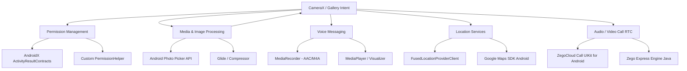

# 📋 Kế Hoạch Triển Khai Kỹ Thuật Chi Tiết - Thành Viên 3 (Multimedia Lead)

> **Dự án:** Chatly - Ứng dụng Giao tiếp Trực tuyến Đa phương tiện  
> **Môn học:** Phát triển ứng dụng trên thiết bị di động (NT118) - Nhóm 12  
> **Phụ trách:** Thành viên 3 (**Multimedia Lead**)  
> **Nền tảng:** Java Android (Min SDK 24 - Target SDK 34), Firebase, ZegoCloud UIKit, Google Maps SDK  

---

## 1. Vai trò & Phạm vi Công việc (Scope of Work)

Thành viên 3 chịu trách nhiệm toàn bộ các tính năng liên quan đến **Đa phương tiện (Multimedia)**, **Tương tác phần cứng & Ngoại vi (Hardware / Sensors)**, **Quyền hạn (Permissions)** và **Hệ thống Cuộc gọi thời gian thực (Call RTC)**:

1. **Quản lý Quyền truy cập (Runtime Permissions):** Xử lý luồng xin quyền thông minh cho Camera, Micro, Vị trí và Bộ nhớ (tương thích Android 7.0 đến Android 14).
2. **Hình ảnh & Media:** Tích hợp Photo Picker API chuẩn Android 13+, nén ảnh trước khi đẩy lên Firebase Storage, hỗ trợ trình xem ảnh/video.
3. **Tin nhắn thoại (Voice Message):** Xử lý ghi âm giọng nói chất lượng cao (`.m4a`/`AAC`) kèm hiệu ứng sóng âm (Waveform) và trình phát audio.
4. **Chia sẻ Vị trí (Location Sharing):** Tích hợp Google Play Services Location (`FusedLocationProviderClient`) và Google Maps SDK để lấy/hiển thị tọa độ trực quan.
5. **Hệ thống Gọi Audio / Video Call:** Tích hợp **ZegoCloud Call Kit / UIKit** cho cuộc gọi thoại và video 1-1 thời gian thực, quản lý trạng thái thiết bị (Mic, Loa ngoài, Camera trước/sau) và ngắt kết nối an toàn.
6. **Tối ưu hóa & Quản lý Bộ nhớ đệm (Cache Management):** Dọn dẹp tệp ghi âm/ảnh tạm, ngăn ngừa rò rỉ bộ nhớ (Memory Leak) khi gọi video/xem media.

---

## 2. Công nghệ & Thư viện Lựa chọn (Tech Stack)



* **Gọi Audio/Video:** `com.github.ZEGOCLOUD:zego_uikit_prebuilt_call_android:+` (ZegoCloud UIKit).
* **Location & Map:** `com.google.android.gms:play-services-location:21.2.0` & `com.google.android.gms:play-services-maps:18.2.0`.
* **Ảnh & Bộ nhớ đệm:** `com.github.bumptech.glide:glide:4.16.0`, Photo Picker API (`ActivityResultContracts.PickVisualMedia`).
* **Audio Voice:** Android SDK `MediaRecorder` & `MediaPlayer` (định dạng `MPEG_4` / `AUDIO_ENCODER_AAC`).
* **Nén ảnh:** `id.zelory:compressor:3.0.1` hoặc custom Bitmap compression.

---

## 3. Lộ trình Thực hiện Chi tiết theo 8 Tuần (Milestones)

### **Tuần 1: Khởi Tạo & Cấu Hình Môi Trường Multimedia**
* [x] Đăng ký tài khoản và tạo App trên **ZegoCloud Admin Console**, lấy `AppID` và `AppSign`.
* [x] Đăng ký **Google Cloud Console**, tạo API Key cho **Maps SDK for Android** và **Places API**.
* [x] Thêm các dependency vào `app/build.gradle` (ZegoCloud, Play Services Location, Maps SDK, Glide, PhotoView, Emoji2).
* [x] Khai báo đầy đủ Permissions trong `AndroidManifest.xml`:
  * `RECORD_AUDIO`, `CAMERA`, `MODIFY_AUDIO_SETTINGS`
  * `ACCESS_FINE_LOCATION`, `ACCESS_COARSE_LOCATION`
  * `READ_MEDIA_IMAGES`, `READ_MEDIA_VIDEO`, `READ_MEDIA_AUDIO` (Android 13+)
* [x] Viết lớp tiện ích `PermissionHelper.java` để tái sử dụng việc kiểm tra và xin quyền ở các Activity/Fragment.

---

### **Tuần 2 & 3: Increment 1 - Hỗ Trợ Avatar, Sticker & Xử Lý Ảnh Cơ Bản**
* [x] **Avatar Picker:** Xây dựng phương thức chọn ảnh đại diện từ Gallery bằng Photo Picker (`MediaPickerHelper.java`).
* [x] **Nén ảnh:** Viết `ImageUtils.java` / `ImageCompressor.java` để resize và nén ảnh (JPEG format, quality 75-80%) trước khi upload để tiết kiệm dung lượng Firebase Storage.
* [x] **Sticker / Emoji:** Tích hợp EmojiCompat hoặc bàn phím Emoji vào Chat Input bar, hỗ trợ UI Lead hoàn thiện giao diện chat cơ bản (`EmojiHelper.java`).
* [x] Phối hợp với Backend Lead kiểm thử upload avatar lên Firebase Storage path: `/users/{userId}/avatar.jpg`.

---

### **Tuần 4 & 5: Increment 2 (Trọng Tâm) - Đa Phương Tiện Toàn Diện**

#### **1. Module Gửi Hình Ảnh & Video (Media Sharing)**
* [x] Triển khai `ActivityResultContracts.PickMultipleVisualMedia` cho phép chọn cùng lúc nhiều ảnh/video (`MediaPickerHelper.java`).
* [x] Viết hàm đọc metadata của tệp (dung lượng `fileSize`, định dạng `mimeType`, tên tệp gốc, thời lượng `durationMs` trong `FileUtils.java`).
* [x] Hỗ trợ quay video/chụp ảnh nhanh qua Camera Intent hoặc CameraX (tạo URI an toàn qua `FileProvider`).
* [x] Tạo `MediaViewerActivity` để xem toàn màn hình hình ảnh (hỗ trợ zoom bằng `PhotoView`) và video (`VideoView`).

#### **2. Module Tin Nhắn Thoại (Voice Messaging)**
* [x] Xây dựng `VoiceRecorderManager.java`:
  * Thiết lập audio source: `MediaRecorder.AudioSource.MIC`.
  * Output format: `MediaRecorder.OutputFormat.MPEG_4`.
  * Audio Encoder: `MediaRecorder.AudioEncoder.AAC`, Sample Rate 44100Hz, Bitrate 128kbps.
  * Xuất file tạm `.m4a` vào `context.getCacheDir()`.
* [x] Xử lý sự kiện ghi âm: Giữ nút để ghi âm (Hold to record), hủy nếu thời lượng < 1 giây hoặc vuốt sang trái (Slide to cancel), polling amplitude cho waveform.
* [x] Xây dựng `VoicePlayerManager.java`:
  * Quản lý `MediaPlayer` phát file âm thanh từ URL hoặc file cục bộ.
  * Cập nhật thanh tiến trình (Seekbar/Waveform) thời gian thực theo tiến độ phát `getCurrentPosition()`.
  * Tự động dừng phát voice cũ khi bấm nghe voice mới hoặc khi thoát màn hình.

#### **3. Module Chia Sẻ Vị Trí (Location Sharing)**
* [x] Xây dựng `LocationHelper.java`:
  * Kiểm tra GPS đã bật chưa (`LocationManager.isProviderEnabled`).
  * Sử dụng `FusedLocationProviderClient.getCurrentLocation()` để lấy vị trí `Latitude`, `Longitude` với độ chính xác cao (`PRIORITY_HIGH_ACCURACY`).
* [x] Tích hợp Google Maps Preview:
  * Hiển thị thumbnail bản đồ tĩnh hoặc MapView mini trong tin nhắn chat.
  * Bấm vào tin nhắn vị trí -> mở màn hình `LocationViewerActivity` (hiển thị Google Maps với Marker và nút mở điều hướng Google Maps).

---

### **Tuần 6: Increment 3 (Trọng Tâm) - Tích Hợp Cuộc Gọi ZegoCloud (Call System)**

#### **1. Cấu hình & Tích hợp ZegoCloud Call Kit**
* [x] Khởi tạo `ZegoUIKitPrebuiltCallService.init()` trong `ChatlyApp.java` ngay sau khi người dùng đăng nhập thành công.
* [x] Xây dựng nút gọi thoại (Audio Call) và nút gọi video (Video Call) trên thanh ActionBar của `ChatActivity`.
* [x] Cấu hình `ZegoSendCallInvitationButton` để gửi lời mời gọi đến đối phương (1-1 Call).
* [x] Xử lý màn hình nhận cuộc gọi đến (Incoming Call Dialog / Notification full-screen).

#### **2. Tùy biến Giao diện & Điều khiển Cuộc gọi (Call Controls)**
* [x] Cấu hình giao diện gọi: Nút tắt/bật Micro (Mute), Nút chuyển Loa trong / Loa ngoài (Speaker), Nút đổi Camera trước/sau, Nút ngắt cuộc gọi.
* [x] Xử lý sự kiện kết thúc cuộc gọi (Call Ended / Call Declined / Busy / Timeout) và ghi log tin nhắn cuộc gọi vào phòng chat (vd: *"Cuộc gọi thoại: 03:45"* hoặc *"Cuộc gọi nhỡ"*).
* [x] Đảm bảo giải phóng tài nguyên Camera & Micro khi kết thúc cuộc gọi hoặc khi ứng dụng chuyển background.

---

### **Tuần 7 & 8: Hoàn Thiện, Tối Ưu Bộ Nhớ & Đóng Gói QC**
* [x] **Quản lý Bộ nhớ đệm (Cache Cleaning):** Tự động dọn dẹp các file `.m4a` và `.jpg` tạm trong `cacheDir` sau khi hoàn tất upload lên Firebase Storage (`FileUtils.cleanupOldTempFiles`).
* [x] **Kiểm thử Quyền hạn:** Test luồng người dùng từ chối cấp quyền (Permission Denied / Don't Ask Again) và hiển thị Dialog hướng dẫn mở Settings thay vì bị crash.
* [x] **Kiểm thử Ngoại lệ mạng & Phần cứng:**
  * Test mất kết nối mạng giữa chừng khi đang upload ảnh/voice.
  * Test khi có cuộc gọi điện thoại SIM (GSM) chen ngang lúc đang gọi ZegoCloud.
* [x] Phối hợp đóng gói bản phát hành APK Release, kiểm tra dung lượng APK và hỗ trợ tài liệu báo cáo nghiệm thu.

---

## 4. Đặc Tả Kỹ Thuật & Cấu Trúc File Code Phụ Trách

```
com.group12.chatly/
├── utils/
│   ├── PermissionHelper.java        # Quản lý xin và kiểm tra runtime permissions
│   ├── FileUtils.java               # Đọc metadata, chuyển URI sang File path, dọn dẹp cache
│   └── ImageCompressor.java         # Nén và resize ảnh bitmap
├── multimedia/
│   ├── voice/
│   │   ├── VoiceRecorderManager.java # Logic khởi tạo MediaRecorder, max duration, cancel
│   │   └── VoicePlayerManager.java   # Logic phát audio, callback tiến độ phát (Seekbar)
│   ├── location/
│   │   └── LocationHelper.java      # Lấy tọa độ GPS qua FusedLocationProviderClient
│   └── call/
│       └── ZegoCallHelper.java       # Khởi tạo Zego SDK, setup call buttons & listeners
└── ui/
    └── media/
        ├── MediaViewerActivity.java  # Xem ảnh zoom / Xem video full-screen
        └── LocationViewerActivity.java # Xem bản đồ Google Maps tương tác
```

---

## 5. Mẫu Mã Logic Cốt Lõi (Reference Implementation)

### 5.1. `PermissionHelper.java` (Chuẩn Android 14)
```java
public class PermissionHelper {
    public static final String[] LOCATION_PERMISSIONS = {
        Manifest.permission.ACCESS_FINE_LOCATION,
        Manifest.permission.ACCESS_COARSE_LOCATION
    };

    public static final String[] AUDIO_PERMISSIONS = {
        Manifest.permission.RECORD_AUDIO
    };

    public static final String[] CALL_PERMISSIONS = {
        Manifest.permission.CAMERA,
        Manifest.permission.RECORD_AUDIO
    };

    public static boolean hasPermissions(Context context, String... permissions) {
        if (context == null || permissions == null) return false;
        for (String permission : permissions) {
            if (ContextCompat.checkSelfPermission(context, permission) 
                    != PackageManager.PERMISSION_GRANTED) {
                return false;
            }
        }
        return true;
    }
}
```

### 5.2. `VoiceRecorderManager.java` (Thu âm chuẩn M4A/AAC)
```java
public class VoiceRecorderManager {
    private MediaRecorder recorder;
    private String outputFilePath;
    private boolean isRecording = false;

    public void startRecording(Context context) throws IOException {
        File cacheFile = new File(context.getCacheDir(), "voice_" + System.currentTimeMillis() + ".m4a");
        outputFilePath = cacheFile.getAbsolutePath();

        recorder = new MediaRecorder();
        recorder.setAudioSource(MediaRecorder.AudioSource.MIC);
        recorder.setOutputFormat(MediaRecorder.OutputFormat.MPEG_4);
        recorder.setAudioEncoder(MediaRecorder.AudioEncoder.AAC);
        recorder.setAudioEncodingBitRate(128000);
        recorder.setAudioSamplingRate(44100);
        recorder.setOutputFile(outputFilePath);

        recorder.prepare();
        recorder.start();
        isRecording = true;
    }

    public String stopRecording() {
        if (isRecording && recorder != null) {
            try {
                recorder.stop();
            } catch (RuntimeException e) {
                // Handle rapid tap / short recording
            }
            recorder.release();
            recorder = null;
            isRecording = false;
            return outputFilePath;
        }
        return null;
    }

    public void cancelRecording() {
        if (isRecording && recorder != null) {
            try {
                recorder.stop();
            } catch (Exception ignored) {}
            recorder.release();
            recorder = null;
            isRecording = false;
        }
        if (outputFilePath != null) {
            new File(outputFilePath).delete();
            outputFilePath = null;
        }
    }
}
```

### 5.3. Khởi tạo ZegoCloud Call Kit (`ChatlyApp.java` / `MainActivity.java`)
```java
public class ZegoCallHelper {
    public static final long APP_ID = 123456789L; // Thay bằng AppID ZegoCloud
    public static final String APP_SIGN = "your_zego_app_sign"; // Thay bằng AppSign ZegoCloud

    public static void initZegoCallService(Application application, String userId, String userName) {
        ZegoUIKitPrebuiltCallInvitationConfig callInvitationConfig = new ZegoUIKitPrebuiltCallInvitationConfig();
        
        ZegoUIKitPrebuiltCallService.init(application, APP_ID, APP_SIGN, userId, userName, callInvitationConfig);
    }

    public static void uninitZegoCallService() {
        ZegoUIKitPrebuiltCallService.unInit();
    }
}
```

---

## 6. Tiêu Chuẩn Nghiệm Thu Tính Năng (Definition of Done - DoD)

| STT | Tính năng | Tiêu chí đạt chuẩn nghiệm thu |
| :---: | :--- | :--- |
| 1 | **Chọn & Gửi Media** | Chọn được ảnh/video qua Photo Picker mà không crash; tệp được nén hợp lý trước khi đẩy lên Firebase Storage; gửi URL vào message. |
| 2 | **Tin nhắn thoại** | Thu âm tối thiểu 1s đến tối đa 2 phút; có thể hủy bằng thao tác vuốt; phát lại âm thanh rõ nét kèm seekbar/sóng âm. |
| 3 | **Chia sẻ vị trí** | Lấy được tọa độ GPS hiện tại chính xác (< 20m); hiển thị pin trên Google Maps; bấm vào xem chi tiết toàn màn hình. |
| 4 | **Cuộc gọi ZegoCloud** | Kết nối cuộc gọi thoại và video 1-1 thành công; âm thanh và hình ảnh rõ ràng; đổi được camera trước/sau; tự động ngắt kết nối an toàn. |
| 5 | **Runtime Permissions** | Kiểm tra quyền trước mọi tác vụ phần cứng; ứng dụng không bao giờ bị crash do lỗi `SecurityException`. |
| 6 | **Tối ưu Cache & Code** | Tệp tạm thời trong `cacheDir` được dọn sạch; không rò rỉ bộ nhớ; mã nguồn có comment đầy đủ và tuân thủ Git Flow. |

