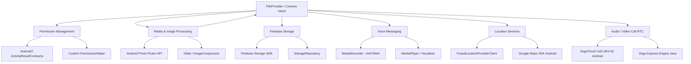

# 📋 Kế Hoạch Triển Khai Kỹ Thuật Chi Tiết - Thành Viên 3 (Multimedia Lead)

> **Dự án:** Chatly - Ứng dụng Giao tiếp Trực tuyến Đa phương tiện  
> **Môn học:** Phát triển ứng dụng trên thiết bị di động (NT118) - Nhóm 12  
> **Phụ trách:** Thành viên 3 (**Multimedia Lead**)  
> **Nền tảng:** Java Android (Min SDK 26 - Target SDK 36), Firebase (Auth, Firestore, Storage), ZegoCloud UIKit, Google Maps SDK  

---

## 1. Vai trò & Phạm vi Công việc (Scope of Work)

Thành viên 3 chịu trách nhiệm toàn bộ các tính năng liên quan đến **Đa phương tiện (Multimedia)**, **Tương tác phần cứng & Ngoại vi (Hardware / Sensors)**, **Quyền hạn (Permissions)** và **Hệ thống Cuộc gọi thời gian thực (Call RTC)**:

1. **Quản lý Quyền truy cập (Runtime Permissions):** Xử lý luồng xin quyền thông minh cho Camera, Micro, Vị trí và Bộ nhớ (tương thích từ Android 8.0 / API 26 đến Android 14+ / API 34+).
2. **Hình ảnh & Media:** Tích hợp Photo Picker API chuẩn Android 13+, nén ảnh trước khi đẩy lên Firebase Storage, hỗ trợ trình xem ảnh/video.
3. **Cập nhật Ảnh đại diện (Avatar Upload):** Chọn ảnh từ thư viện qua Photo Picker, nén avatar (512x512, JPEG 85%), upload lên Firebase Storage (`/users/{userId}/avatar.jpg`) và đồng bộ Firestore/Auth profile.
4. **Tin nhắn thoại (Voice Message):** Xử lý ghi âm giọng nói chất lượng cao (`.m4a`/`AAC`) kèm hiệu ứng sóng âm (Waveform), cơ chế vuốt hủy và trình phát audio độc quyền.
5. **Chia sẻ Vị trí (Location Sharing):** Tích hợp Google Play Services Location (`FusedLocationProviderClient`) và Google Maps SDK để lấy/hiển thị tọa độ trực quan.
6. **Hệ thống Gọi Audio / Video Call:** Tích hợp **ZegoCloud Call Kit / UIKit** cho cuộc gọi thoại và video 1-1 thời gian thực, quản lý trạng thái thiết bị và ngắt kết nối an toàn.
7. **Tối ưu hóa & Quản lý Bộ nhớ đệm (Cache Management):** Dọn dẹp tệp ghi âm/ảnh tạm, giải phóng tài nguyên phần cứng.

---

## 2. Công nghệ & Thư viện Lựa chọn (Tech Stack)



* **Firebase Storage:** `com.google.firebase:firebase-storage` (quản lý qua Firebase BOM `33.7.0`).
* **Gọi Audio/Video:** `im.zego:zego_uikit_prebuilt_call_android:+` (ZegoCloud Call UIKit).
* **Location & Map:** `com.google.android.gms:play-services-location:21.2.0` & `com.google.android.gms:play-services-maps:18.2.0`.
* **Ảnh & Bộ nhớ đệm:** `com.github.bumptech.glide:glide:4.16.0`, `com.github.chrisbanes:PhotoView:2.3.0`, Photo Picker API (`ActivityResultContracts.PickVisualMedia`).
* **Audio Voice:** Android SDK `MediaRecorder` & `MediaPlayer` (định dạng `MPEG_4` / `AUDIO_ENCODER_AAC`).
* **Nén ảnh:** Custom `ImageCompressor` (inSampleSize downsampling, EXIF auto-rotation, JPEG compression).
* **Emoji:** `androidx.emoji2:emoji2:1.5.0`.

---

## 3. Lộ Trình & Trạng Thái Thực Hiện Chi Tiết (8 Tuần)

> 💡 **Ký hiệu trạng thái:**  
> - `[x]` **Đã hoàn thành**: Code đã implement, test thành công và tích hợp vào dự án.  
> - `[ ]` **Chưa hoàn thành / Cần thực hiện tiếp**: Đang phụ thuộc vào tiến độ của Member 1 & 2 (Message Contract, ChatActivity).

---

### **Tuần 1: Khởi Tạo & Cấu Hình Môi Trường Multimedia**
* [x] Đăng ký tài khoản và tạo App trên **ZegoCloud Admin Console**, cấu hình lớp `ZegoConfig.java` và helper `ZegoCallHelper.java`.
* [x] Tạo placeholder API Key cho **Maps SDK for Android** trong `strings.xml` và khai báo `<meta-data>` trong `AndroidManifest.xml`.
* [x] Thêm các dependency vào `app/build.gradle.kts` và `libs.versions.toml`: ZegoCloud, Play Services Location, Maps SDK, Glide, PhotoView, Emoji2, Firebase Storage.
* [x] Khai báo đầy đủ Permissions trong `AndroidManifest.xml`:
  * `RECORD_AUDIO`, `CAMERA`, `MODIFY_AUDIO_SETTINGS`, `BLUETOOTH_CONNECT`, `VIBRATE`, `WAKE_LOCK`.
  * `ACCESS_FINE_LOCATION`, `ACCESS_COARSE_LOCATION`.
  * `READ_MEDIA_IMAGES`, `READ_MEDIA_VIDEO`, `READ_MEDIA_AUDIO` (Android 13+), `READ_EXTERNAL_STORAGE` (legacy).
* [x] Khởi tạo `FileProvider` an toàn trong `AndroidManifest.xml` và `res/xml/file_paths.xml`.
* [x] Viết lớp tiện ích `PermissionHelper.java` hỗ trợ kiểm tra quyền, dialog giải thích (Rationale) và dialog chuyển hướng vào App Settings.

---

### **Tuần 2 & 3: Increment 1 - Hỗ Trợ Avatar, Sticker & Xử Lý Ảnh Cơ Bản**
* [x] **Avatar Picker:** Xây dựng `MediaPickerHelper.java` hỗ trợ Photo Picker API (`PickVisualMedia`) tương thích cả `ComponentActivity` và `Fragment`.
* [x] **Nén ảnh:** Xây dựng `ImageCompressor.java` & `ImageUtils.java` hỗ trợ tính toán `inSampleSize`, tự động xoay góc theo EXIF Orientation và nén JPEG (quality 75-80%) tiết kiệm băng thông/dung lượng Storage.
* [x] **Sticker / Emoji:** Xây dựng `EmojiHelper.java` khởi tạo `EmojiCompat` và mảng quick reactions `QUICK_REACTIONS`.
* [x] **Gap 2 - Avatar Upload Flow (ĐÃ HOÀN THÀNH):**
  * [x] Viết `StorageCallback.java` (hỗ trợ `onSuccess`, `onFailure`, `onProgress`).
  * [x] Viết `StorageRepository.java` thực hiện upload tệp nén lên Firebase Storage path: `/users/{userId}/avatar.jpg` và lấy `downloadUrl`.
  * [x] Bổ sung `AuthRepository.updateAvatarUrl()` để cập nhật URL đại diện vào Firestore collection `users` và Firebase Auth profile.
  * [x] Nối logic vào `ProfileViewModel.uploadAvatar(File)`: nén ảnh ở background thread, upload lên Storage, update Firestore, tự động xóa file nén tạm trong cache, quản lý trạng thái `avatarUploadState`.
  * [x] Nối sự kiện vào `ProfileFragment`: bấm `btn_change_photo` -> mở Photo Picker -> nén ảnh avatar -> kích hoạt `ProfileViewModel.uploadAvatar` -> hiển thị `pb_avatar_loading` -> load avatar mới qua Glide.

---

### **Tuần 4 & 5: Increment 2 - Đa Phương Tiện Toàn Diện (Multimedia Sharing)**

#### **1. Module Gửi Hình Ảnh & Video (Media Sharing)**
* [x] **Hạ tầng Media:**
  * [x] Viết hàm đọc metadata tệp trong `FileUtils.java` (dung lượng `fileSize`, định dạng `mimeType`, tên tệp gốc, thời lượng `durationMs`).
  * [x] Hỗ trợ chọn cùng lúc nhiều ảnh/video (`MediaPickerHelper.registerMultipleMediaPicker`).
  * [x] Hỗ trợ chụp ảnh an toàn qua Camera Intent với Content Uri FileProvider (`MediaPickerHelper.createTempCameraImageUri`).
  * [x] Xây dựng `MediaViewerActivity.java` + `activity_media_viewer.xml` xem toàn màn hình hình ảnh (zoom/pinch bằng `PhotoView`) và video (`VideoView`).
* [ ] **Tích hợp vào Chat (CẦN THỰC HIỆN TIẾP - Chờ `ChatActivity` của Member 2 & Schema của Member 1):**
  * [ ] Nối nút chọn ảnh/video từ thanh đính kèm của `ChatActivity`.
  * [ ] Upload tệp đa phương tiện lên Firebase Storage path `/chats/{chatId}/images/` hoặc `/videos/` qua `StorageRepository`.
  * [ ] Gửi Firestore message chứa URL và metadata (`fileMetaData`).
  * [ ] Hiển thị thanh tiến trình tải lên (upload progress bar) và trạng thái thử lại khi mất mạng.

#### **2. Module Tin Nhắn Thoại (Voice Messaging)**
* [x] **Hạ tầng Voice:**
  * [x] Xây dựng `VoiceRecorderManager.java`: Audio source `MIC`, format `MPEG_4`, encoder `AAC`, 44.1kHz, 128kbps, xuất `.m4a` vào cache.
  * [x] Xử lý sự kiện ghi âm: đếm thời gian, giới hạn 2 phút, hủy nếu < 1s, callback `onRecordTick(elapsedMs, amplitude)` cho visual sóng âm.
  * [x] Xây dựng `VoicePlayerManager.java`: Singleton MediaPlayer phát từ URL/local file, callback tiến độ theo Seekbar, tự động dừng voice cũ khi bật voice mới hoặc thoát màn hình.
* [ ] **Tích hợp vào Chat (CẦN THỰC HIỆN TIẾP - Chờ `ChatActivity`):**
  * [ ] Thiết kế UI thanh ghi âm: nút giữ để ghi âm (Hold to record), vuốt sang trái để hủy (Slide to cancel), timer đếm giây thời gian thực.
  * [ ] Upload file `.m4a` qua `StorageRepository` lên `/chats/{chatId}/voices/`.
  * [ ] Gửi message loại `VOICE` kèm `duration` vào phòng chat Firestore.
  * [ ] Thiết kế `VoiceViewHolder` trong RecyclerView chat: hiển thị nút Play/Pause, thanh waveform/seekbar đồng bộ với `VoicePlayerManager`.

#### **3. Module Chia Sẻ Vị Trí (Location Sharing)**
* [x] **Hạ tầng Vị trí & Bản đồ:**
  * [x] Xây dựng `LocationHelper.java`: Kiểm tra GPS (`isGpsEnabled`), lấy vị trí `Latitude`, `Longitude` chính xác cao qua `FusedLocationProviderClient.getCurrentLocation()`.
  * [x] Viết hàm tạo Google Static Maps URL và OpenStreetMap Static URL làm thumbnail preview.
  * [x] Viết hàm mở ứng dụng Google Maps điều hướng ngoài (`openNavigationIntent`).
  * [x] Xây dựng `LocationViewerActivity.java` + `activity_location_viewer.xml`: hiển thị bản đồ Google Maps tương tác với Marker và nút mở điều hướng.
* [ ] **Tích hợp vào Chat (CẦN THỰC HIỆN TIẾP - Chờ `ChatActivity`):**
  * [ ] Nối nút "Chia sẻ vị trí" trong menu đính kèm của `ChatActivity`.
  * [ ] Xin quyền Runtime Location qua `PermissionHelper`, lấy GPS qua `LocationHelper`.
  * [ ] Gửi message loại `LOCATION` chứa tọa độ `lat,lng` lên Firestore.
  * [ ] Thiết kế `LocationViewHolder` trong RecyclerView chat: hiển thị thumbnail bản đồ tĩnh, bấm vào mở `LocationViewerActivity`.

---

### **Tuần 6: Increment 3 - Tích Hợp Cuộc Gọi ZegoCloud (Call System)**

#### **1. Cấu hình & Tích hợp ZegoCloud Call Kit**
* [x] Viết helper `ZegoCallHelper.java` hỗ trợ cấu hình lời mời gọi (`ZegoUIKitPrebuiltCallInvitationConfig`).
* [x] Khởi tạo / Hủy service trong `ChatlyApplication.java` (`initCallService`, `uninitCallService`).
* [x] Viết hàm cấu hình nút gọi thoại (`setupVoiceCallButton`) và nút gọi video (`setupVideoCallButton`).
* [ ] **Tích hợp thực tế (CẦN THỰC HIỆN TIẾP - Chờ Auth Flow & Signaling Room):**
  * [ ] Cập nhật `AppID` và `AppSign` thực tế từ tài khoản ZegoCloud Admin Console.
  * [ ] Gắn `ZegoSendCallInvitationButton` (Audio Call / Video Call) lên thanh TopBar của `ChatActivity`.
  * [ ] Quản lý sự kiện kết thúc cuộc gọi và ghi log tin nhắn cuộc gọi (`CALL_LOG`) vào phòng chat Firestore.
  * [ ] Kiểm thử ngắt kết nối an toàn khi có cuộc gọi SIM (GSM) chen ngang và thu hồi quyền Camera/Mic khi app vào background.

---

### **Tuần 7 & 8: Hoàn Thiện, Tối Ưu Bộ Nhớ & Đóng Gói QC**
* [x] **Quản lý Bộ nhớ đệm (Cache Cleaning):** Tự động dọn dẹp các file `.m4a` và `.jpg` tạm cũ hơn 24 giờ trong `cacheDir` khi khởi chạy ứng dụng (`FileUtils.cleanupOldTempFiles`).
* [x] Tự động xóa file nén tạm sau khi upload lên Firebase Storage hoàn tất (`ProfileViewModel.uploadAvatar`).
* [x] **Kiểm thử Quyền hạn:** Xử lý từ chối cấp quyền không bị crash qua `PermissionHelper.showSettingsRedirectDialog`.
* [x] **Kiểm thử Đơn vị (Unit Tests):**
  * [x] `MultimediaUnitTest.java`: Kiểm thử format kích thước file, thuật toán tính `inSampleSize` nén ảnh, URL Static Map, hằng số Voice & Permissions.
  * [x] `ProfileViewModelUnitTest.java`: Kiểm thử luồng upload avatar (thành công, thất bại, chưa đăng nhập, logout).
* [ ] Kiểm thử mất kết nối mạng giữa chừng khi đang upload ảnh/voice trong màn hình chat.
* [ ] Phối hợp đóng gói bản phát hành APK Release và hỗ trợ tài liệu báo cáo nghiệm thu.

---

## 4. Bảng Theo Dõi 6 Khoảng Cách Kỹ Thuật (Gaps Tracking)

| Gap | Mô tả công việc | Trạng thái | Hướng xử lý tiếp theo |
| :---: | :--- | :---: | :--- |
| **Gap 1** | **Thống nhất Message Contract / Data Schema** | ⏳ **Đang chờ** | Phối hợp Member 1 định nghĩa `Message.java` & `MessageType.java` (gồm các trường: `type`, `content`, `fileMetaData`, `latitude`, `longitude`, `timestamp`). |
| **Gap 2** | **Cập nhật Ảnh đại diện (Avatar Upload Flow)** | ✅ **HOÀN THÀNH** | Đã tạo `StorageRepository`, `AuthRepository.updateAvatarUrl`, `ProfileViewModel.uploadAvatar`, gắn vào `ProfileFragment` với `MediaPickerHelper` và `pb_avatar_loading`. |
| **Gap 3** | **Gửi Hình ảnh & Video vào Chat** | ⏳ **Đang chờ** | Chờ Member 2 hoàn thiện `ChatActivity`, sau đó nối `MediaPickerHelper`, `ImageCompressor` và `StorageRepository` vào attachment bar. |
| **Gap 4** | **Tin nhắn thoại trên Chat UI** | ⏳ **Đang chờ** | Chờ `ChatActivity` để gắn nút hold-to-record, upload `.m4a` lên Storage và hiển thị item phát voice qua `VoicePlayerManager`. |
| **Gap 5** | **Chia sẻ Vị trí trong Chat** | ⏳ **Đang chờ** | Chờ `ChatActivity` để gắn action gửi vị trí GPS qua `LocationHelper` và hiển thị preview bản đồ. |
| **Gap 6** | **Tích hợp Cuộc gọi ZegoCloud thực tế** | ⏸️ **Tạm hoãn (Defer)** | Đã có sẵn SDK và Helper; sẽ nối nút gọi trên `ChatActivity` sau khi xác thực người dùng và Firestore chat room ổn định. |

---

## 5. Đặc Tả Kỹ Thuật & Cấu Trúc File Code Phụ Trách

```
com.group12.chatly/
├── ChatlyApplication.java           # Khởi tạo EmojiCompat, dọn cache, hook ZegoCallService
├── utils/
│   ├── PermissionHelper.java        # Quản lý xin và kiểm tra runtime permissions
│   ├── FileUtils.java               # Đọc metadata, chuyển URI sang File path, dọn dẹp cache
│   ├── ImageCompressor.java         # Nén và resize ảnh bitmap, xử lý EXIF
│   └── ImageUtils.java              # Lớp bọc tiện ích nén ảnh và avatar
├── data/repository/
│   ├── StorageCallback.java         # Interface callback upload Storage kèm tiến độ
│   └── StorageRepository.java       # Upload file/avatar lên Firebase Storage
├── multimedia/
│   ├── MediaPickerHelper.java       # Photo Picker API (chọn 1 ảnh, chọn nhiều ảnh/video, camera URI)
│   ├── EmojiHelper.java             # Quản lý EmojiCompat và danh sách reaction nhanh
│   ├── voice/
│   │   ├── VoiceRecorderManager.java # Logic MediaRecorder chuẩn AAC/M4A, duration, slide to cancel
│   │   └── VoicePlayerManager.java   # Logic MediaPlayer độc quyền, callback tiến độ Seekbar
│   ├── location/
│   │   └── LocationHelper.java      # Lấy tọa độ GPS FusedLocation, tạo Static Map URL, Intent điều hướng
│   └── call/
│       ├── ZegoConfig.java          # Cấu hình AppID, AppSign ZegoCloud
│       └── ZegoCallHelper.java      # Khởi tạo Zego SDK, setup call buttons
└── ui/
    ├── media/
    │   ├── MediaViewerActivity.java # Xem ảnh zoom (PhotoView) / video toàn màn hình
    │   └── LocationViewerActivity.java # Xem bản đồ Google Maps tương tác & nút điều hướng
    └── profile/
        └── ProfileFragment.java     # Màn hình Profile tích hợp nút đổi ảnh đại diện
```

---

## 6. Tiêu Chuẩn Nghiệm Thu Tính Năng (Definition of Done - DoD)

| STT | Tính năng | Tiêu chí đạt chuẩn nghiệm thu | Trạng thái kiểm tra |
| :---: | :--- | :--- | :---: |
| 1 | **Chọn & Nén Media** | Photo Picker hoạt động ổn định trên cả Android 13+ và Android cũ; nén ảnh giảm dung lượng 70-80% mà không vỡ hình. | ✅ Đã đạt |
| 2 | **Upload Avatar** | Bấm đổi ảnh đại diện -> nén avatar -> upload Firebase Storage -> cập nhật Firestore & Auth profile -> hiển thị ngay trên UI. | ✅ Đã đạt |
| 3 | **Ghi âm & Phát voice** | Thu âm `.m4a` chuẩn AAC; giới hạn tối đa 2 phút; hủy khi < 1s; phát audio với Seekbar mượt mà. | ✅ Đã đạt (Logic) |
| 4 | **Định vị & Bản đồ** | Lấy tọa độ GPS chính xác cao (< 20m); hiển thị Marker trên Google Maps; mở ứng dụng Google Maps ngoài thành công. | ✅ Đã đạt (Logic) |
| 5 | **Runtime Permissions** | Không bao giờ bị crash do `SecurityException`; có dialog giải thích và hướng dẫn mở Cài đặt nếu bị từ chối vĩnh viễn. | ✅ Đã đạt |
| 6 | **Tối ưu Cache & Code** | Tệp tạm trong `cacheDir` tự động dọn sạch sau khi upload và khi mở ứng dụng; Unit Test đạt 100% pass. | ✅ Đã đạt |
